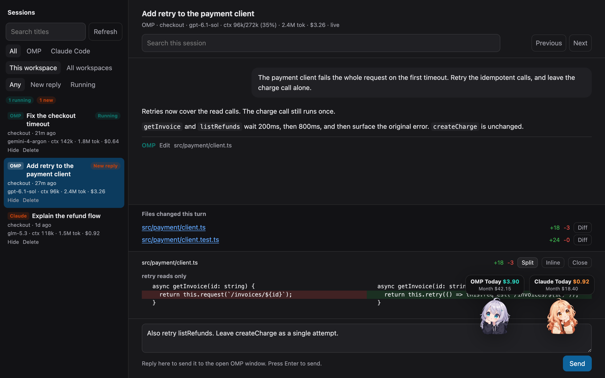
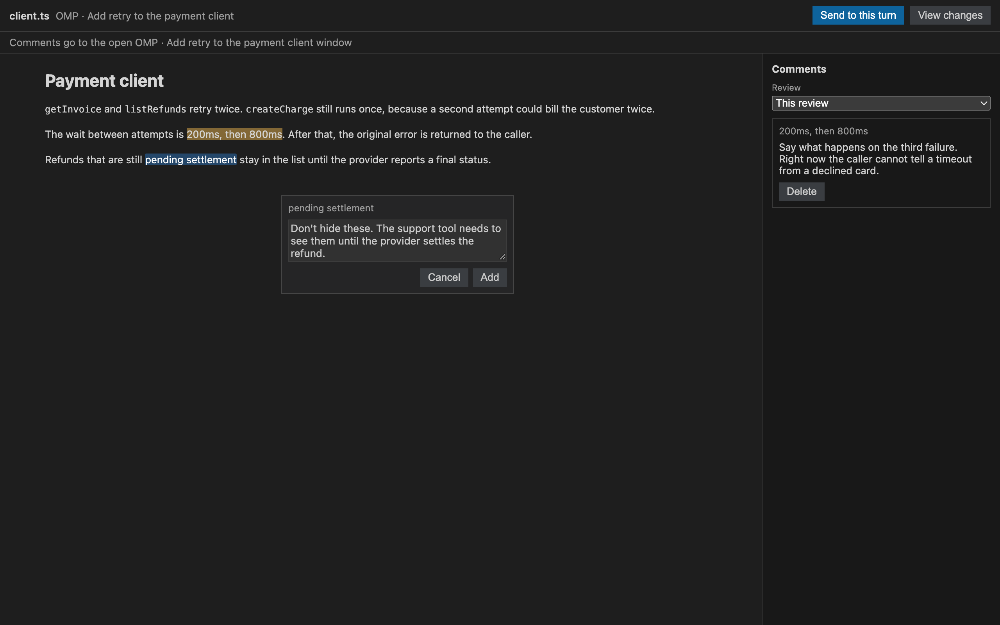

# Agent Sessions

You leave a few coding agents running and come back to a row of terminals. Which one finished, which one is still working, and which window you should type into are all buried in those terminals. Agent Sessions is a Cursor panel that answers that from the sessions OMP and Claude Code already saved. Open it with **Sessions: Open Session Library**.

## You come back and every terminal looks the same

Opening each one to see whether it answered is the slow part. The list marks the session that just replied and the one still running, along with each session's model, context usage, total tokens, and estimated cost. Click **1 new** or **1 running** and those are the only rows. The session you have open keeps updating while you read it.

The follow-up goes in the box at the bottom. When the OMP window is still open, Send pastes it there, so you can answer the session you are reading. Claude Code sessions can be read the same way. Under the reply, the files that turn changed are listed, and Diff opens the change in the panel before you answer.

**This workspace** keeps the list to the repo you have open. Sessions from other directories show up under **All workspaces**. A draggable mascot widget in the corner shows **Today** and **Month** spend for OMP and Claude Code (right-click it to switch characters, pick a custom image, or minimize it).

## You want to mark one sentence, and then the agent rewrites the file

Telling the agent "look at the file" leaves it to guess which sentence you mean. Select the passage and choose **Comment**. The highlight and the quoted text stay put, so you can step away and still see what the note is about.

**Send to this turn** pastes this review into the open OMP window. Once you send it, or once you open the file again after the agent has changed it, the next review starts empty, so an old note is not sent again as if it were about the new text. The earlier review stays in the **Review** menu, and **View changes** shows what happened to the file since that pass.

## Install

In Cursor, open Extensions and search for **Agent Sessions** (`jinxinyang.agent-sessions`). The listing is on [Open VSX](https://open-vsx.org/extension/jinxinyang/agent-sessions).

To build from this repository, run `npm install` and then `npm run package`. Install that `.vsix` with **Extensions: Install from VSIX…**.
